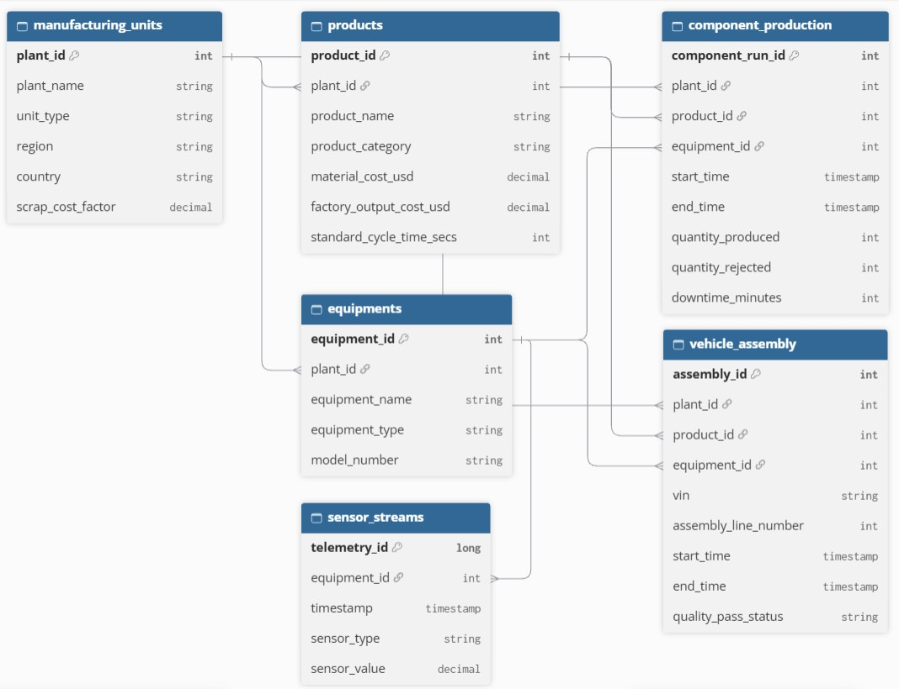

# AmpereDrive Giga — EV Manufacturing & Telemetry Data Platform

An end-to-end, metadata-driven Azure and Databricks lakehouse platform built to unify global EV manufacturing operations, vehicle assembly tracking, and high-frequency IoT equipment telemetry into analytics-ready datasets.

  

---

## 🏗️ System Architecture

The platform follows a scalable **Medallion Architecture (`Bronze` → `Silver` → `Gold`)** governed by Databricks Unity Catalog and orchestrated dynamically via Azure Data Factory.

* **Multi-Source Ingestion:** Integrates relational operational data from **PostgreSQL** alongside flat-file manufacturing logs from **Azure Data Lake Storage (ADLS)** using **Azure Data Factory (ADF)**.
* **Metadata-Driven Orchestration:** Pipeline execution, incremental watermarking, and run-level auditing are centrally controlled through a custom framework hosted on **Azure SQL DB**.
* **Lakehouse Transformation (`amperedrive_giga`):**
  * **Bronze Layer:** Captures raw, immutable historical snapshots from source systems.
  * **Silver Layer:** Cleanses, standardizes, and applies historical tracking (SCD Type 1 & Type 2) across core manufacturing entities and IoT sensor streams.
  * **Gold Layer:** Models curated data into an enterprise **Star Schema** optimized for manufacturing KPIs, yield analytics, and hourly equipment telemetry insights.
* **Governance & Observability:** Enforces centralized access control and lineage via **Databricks Unity Catalog**, automated data quality checks prior to Gold publishing, and real-time pipeline status notifications via **Azure Logic Apps** and **Gmail**.
* **CI/CD Automation:** Integrated with **GitHub** for automated version control and deployment across ADF pipelines and Databricks workspaces.
* **Downstream Consumption:** Powers interactive executive reporting via **Databricks Dashboards** and enables natural-language self-service exploration through **Databricks Genie Agents**.

---

## 🚀 Key Engineering Highlights

* **Zero-Hardcoding Ingestion:** Adding new source tables or files requires only a metadata configuration entry in Azure SQL DB rather than building new ADF pipelines.
* **Hybrid Load Patterns:** Seamlessly handles full snapshots, watermark-based incremental merges (SCD Type 1 & Type 2), and high-volume append-only IoT streams.
* **Built-In Data Quality Guardrails:** Enforces automated validation checks (referential integrity, duplicate prevention, and cost/yield bounds) before promoting data to the Gold layer.
* **End-to-End Observability:** Tracks row counts, execution durations, and failure states per pipeline run, triggering automated status alerts via Azure Logic Apps.

---

## 🛠️ Tech Stack

* **Cloud & Storage:** Microsoft Azure, Azure Data Lake Storage (ADLS Gen2), Azure SQL Database
* **Data Integration & Orchestration:** Azure Data Factory (ADF), Azure Logic Apps
* **Data Engineering & Governance:** Azure Databricks, Apache Spark / PySpark, Delta Lake, Unity Catalog
* **Analytics & AI:** Databricks AI/BI Dashboards, Databricks Genie
* **DevOps:** GitHub (CI/CD integration for ADF & Databricks)

---

## 🧬 Source ER

  

